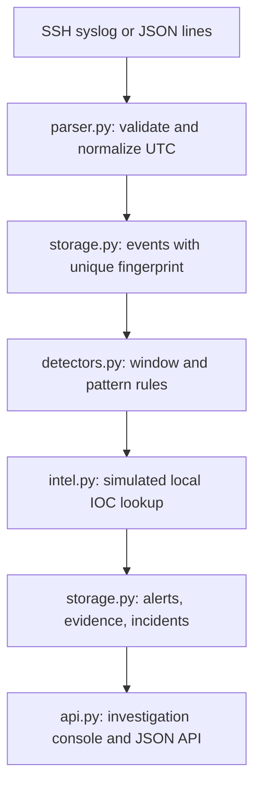

# Mini SIEM — local investigation lab

A small security event pipeline for an interview demonstration. It reads SSH syslog or JSON-line telemetry, normalizes and stores events in SQLite, evaluates deterministic rules, attaches **simulated local** IOC context, and groups related alerts into investigable incidents. It is a learning product, not a production SIEM.

## Run the deterministic demo

Python 3.10+ is required. From the repository root:

```bash
python -m venv .venv
# macOS/Linux: source .venv/bin/activate
# Windows PowerShell: .venv\Scripts\Activate.ps1
python -m pip install -r requirements.txt
python src/main.py --once --log data/demo.jsonl --db data/alerts.db
python src/api.py
```

Open http://127.0.0.1:5001. The demo fixture contains nine **simulated** records, yielding three alerts and two incidents in an empty database. A replay of identical lines yields zero new records or alerts. The dashboard uses `data/alerts.db` by default. For another database, set `SIEM_DB` before starting the API. To run the original SSH sample instead, use `python src/main.py --once --year 2026`. For live tailing, use `python src/main.py --log PATH` (starts at end) or add `--from-start`.

Run tests: `python -m unittest discover -s tests -v`.

## Architecture



`main.py` orchestrates ingestion and enrichment before detection; the diagram presents the logical stages. Every accepted event is stored, including benign events. The normalized fields include timestamp, source, type, IP, username, host, raw event, and a simulated flag. JSON network records can carry a destination port; web records carry a path. SSH syslog has no year or zone; `--year` supplies the year and the parser **assumes UTC**. JSON timestamps require an explicit timezone and are converted to UTC. Unsupported/malformed lines are skipped. The fingerprint is SHA-256 of source and raw line, so exact replays are ignored; identical genuine lines may also be collapsed.

## Detection rules and evidence

| Rule | Required telemetry and logic | ATT&CK | False-positive concern |
| --- | --- | --- | --- |
| AUTH-001 | Five SSH/JSON auth failures from one IP within 60 seconds; one alert per burst | [T1110](https://attack.mitre.org/techniques/T1110/) | Shared IPs, user errors |
| AUTH-002 | Success from an IP with five recent failures in 60 seconds | [T1110](https://attack.mitre.org/techniques/T1110/) context | The successful user may differ; investigate rather than assume compromise |
| WEB-001 | Decoded request path matches selected SQL injection or traversal strings | [T1190](https://attack.mitre.org/techniques/T1190/) hypothesis | Scanners and benign strings; no evidence of exploitation |
| NET-001 | Five distinct destination ports attempted by one IP within 60 seconds | None | Legitimate monitoring; no connection outcome supplied |

Threshold and window are constructor parameters of `BruteForceDetector`; the CLI uses five and 60 seconds. Alerts record rule ID, triggering timestamp, explanation, heuristic score, source IP and evidence event IDs via `alert_evidence`. An incident groups alerts sharing a source IP within 30 minutes of its last alert. Its timeline shows linked raw events. This correlation is intentionally narrow and assumes ordered input.

`intel.py` reads `data/demo_iocs.json` and caches lookups in memory. `192.0.2.23` is a reserved **TEST-NET** address with a fabricated training record. A `match` means a match in that simulated fixture, **not** a live reputation finding. `not_found`, `invalid`, and `unavailable` are distinct outcomes. No data leaves the machine. The local indicator context is stored with each event and alert. Live AbuseIPDB/VirusTotal calls were deferred: API credentials, quotas, privacy decisions, and error semantics would add risk within the interview deadline.

Risk is a **heuristic priority score, not a probability**. Bases: authentication burst 55, success after failures 80, web pattern 45, port attempts 50. A local IOC match adds 15 once to the alert score, capped at 100. Incident score is the maximum linked alert score plus five for a related success alert, capped at 100. A local IOC match enriches detections; it does not generate an independent alert. No decay or statistical calibration is claimed.

## API and analyst workflow

- `GET /api/overview`: persisted event, alert, incident, open incident, and matching-event counts.
- `GET /api/events?ip=192.0.2.23`: recent events, optionally filtered by exact IP.
- `GET /api/alerts`, `GET /api/incidents`, `GET /api/incidents/<id>`: alerts, incident list, linked evidence and timeline.
- `PATCH /api/incidents/<id>` with `{"status":"investigating"}`: persist `new`, `investigating`, `resolved`, or `false_positive`; invalid input returns 400.

In the console, open incident #1: the five failures trigger AUTH-001; the success triggers AUTH-002; both link to the same incident and six source events. Review the local IOC label and risk explanation, then set status to Investigating. Incident #2 contains the web pattern; the benign web request produces no alert. Show `src/detectors.py` to explain the actual threshold/window logic.

## Security and limits

The server binds to localhost and has **no authentication**, so do not expose it publicly or ingest sensitive production logs. Status changes have no analyst audit trail. The parser supports a narrow SSH syslog subset and specified JSON event types. File tailing handles truncation of the same file, not rotation/restart offsets. Rule state and IOC cache are process-local; restarting mid-window loses detection history. No provider API, real reputation verdict, verified attack outcome, web response codes, automated containment, or production-scale ingest is implemented. The demo timestamps are fixed; these are historical training events. Before production: identity and access control, bounded input/ingest rate, durable offsets and window state, schema migrations, audit logs, secret management for any opt-in provider, provider timeouts and quotas, and operational monitoring.

See [interview notes](docs/interview.md) for a timed walkthrough and difficult questions.
