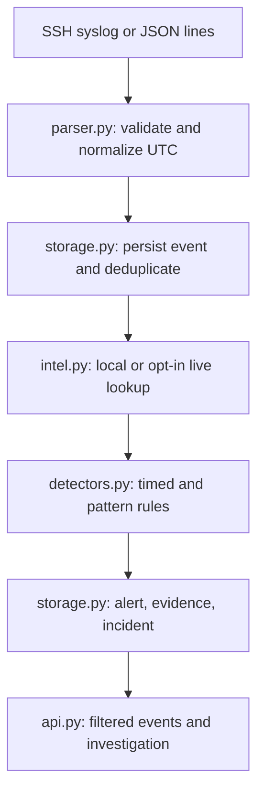

# Mini SIEM — evidence-driven local investigation lab

A compact security event pipeline for learning and interview demonstration. It ingests SSH syslog and JSON lines, stores normalized and raw events in SQLite, evaluates deterministic detection rules, adds IOC context, and links supporting evidence to incidents. The default demo is offline and fully simulated. This is not a production SIEM.

## Quick start

Python 3.10+:

```bash
python -m venv .venv
# macOS/Linux: source .venv/bin/activate
# Windows PowerShell: .venv\Scripts\Activate.ps1
python -m pip install -r requirements.txt
python src/main.py --once --log data/demo.jsonl --db data/alerts.db
python src/api.py
```

Open http://127.0.0.1:5001. In a fresh database the **14 simulated records** produce **four alerts and three incidents**: authentication burst, related successful login, suspicious web request, and distinct-port activity. Six events match the simulated local IOC; this is an event count, not six different indicators. Re-running the fixture adds zero events or alerts. Use a new database path and set `SIEM_DB` for the API if you want a clean first run. Run tests with `python -m unittest discover -s tests -v`.

For the original SSH sample: `python src/main.py --once --year 2026`. For live monitoring: `python src/main.py --log PATH`; it starts at end on first launch and resumes its stored byte offset thereafter. `--from-start` processes existing lines, with duplicates skipped. The monitor detects same-path truncation and inode rotation. It checkpoints after each complete line and rebuilds in-memory rule windows from stored events on restart.

## Architecture



`main.py` coordinates these steps. SSH syslog lacks year and timezone: the supplied/default year is used and UTC is assumed. JSON timestamps must have a timezone. Supported JSON `type` values are `auth_fail`, `auth_success`, `web_request`, and `network_connection`. Relevant searchable fields include source IP, type, username, host, source, web path, HTTP status, destination IP/port and connection outcome. Original input is preserved in `raw_event`. The unique file-record identity includes path, device/inode, byte offset and line digest; arbitrary line streams use a source-plus-raw digest. Identical lines at distinct offsets are retained, while file replays are idempotent.

SQLite tables: `events`, `alerts`, `alert_evidence`, `incidents`, `incident_alerts`, `ingest_offsets`, and `incident_actions`. Existing databases receive additive columns on startup. The rule state is reconstructed from stored events without creating new alerts; this is a simple O(total events) recovery strategy suited to a small local database.

## Detection and correlation

| Rule | Logic | ATT&CK interpretation | Limit |
| --- | --- | --- | --- |
| AUTH-001 | Five failures from the same IP and host in 60 seconds | [T1110](https://attack.mitre.org/techniques/T1110/) | Shared sources and legitimate errors |
| AUTH-002 | Success from that IP and host after five recent failures; if usernames exist, the account must match | [T1110](https://attack.mitre.org/techniques/T1110/) context | A success does not prove account takeover |
| WEB-001 | Decoded path matches selected traversal or SQL-injection-like strings | [T1190](https://attack.mitre.org/techniques/T1190/) hypothesis | HTTP status is shown, but does not establish exploitation |
| NET-001 | Five distinct ports to the same destination IP from one source in 60 seconds | No mapping claimed | Connection outcome is recorded where supplied; benign scans exist |

Threshold and window are parameters of `BruteForceDetector` (CLI defaults: five and 60 seconds). Alert evidence references the relevant stored event IDs. Incidents correlate alerts from the same IP **and host** if a subsequent alert arrives within 30 minutes. Input is expected in chronological order. The risk score is a **heuristic priority, not a probability**: base 55 for AUTH-001, 80 for AUTH-002, 45 for WEB-001, 50 for NET-001; an IOC match adds 15 once. Incident priority is the highest linked alert score plus five if AUTH-002 is present, capped at 100.

## Threat intelligence

The default `SIEM_INTEL_PROVIDER=local` loads `data/demo_iocs.json`. Its reserved TEST-NET address `192.0.2.23` has a **fabricated training record**, never a real-world malicious verdict. The local lookup distinguishes `match`, `not_found`, `invalid`, and `unavailable` and records lookup time.

Optional AbuseIPDB APIv2 support is **off by default**. Set `SIEM_INTEL_PROVIDER=abuseipdb` and `ABUSEIPDB_API_KEY` in your environment (the `.env.example` file is documentation, not auto-loaded). A local fixture match takes precedence. Only globally routable public IP addresses without local matches are sent to `https://api.abuseipdb.com/api/v2/check` using the `ipAddress` and `maxAgeInDays=90` parameters; the IP address leaves your machine. The provider returns `match` for an abuse confidence score of at least 75, `reported` for lower nonzero reports, `not_found` for zero reports, and `error` for request/response failures. This threshold is our triage choice, not a provider guarantee. It uses a three-second timeout, a 15-minute in-memory cache, and a 100-request per-process budget. API failures never mean benign. No key or external service is needed for tests or the demo. The live path is mocked in tests; it has not been verified with a real API key. See [official APIv2 documentation](https://docs.abuseipdb.com/) for provider behavior and account-specific quotas.

## API and analyst workflow

- `GET /api/overview`: counts from stored data.
- `GET /api/events?ip=...&type=...&username=...&host=...&source=...&path=...&destination_ip=...&destination_port=...&http_status=...&connection_outcome=...`: recent exact-match filters except `path`, which is a literal substring; up to 100 by default. The dashboard exposes the common IP, type, username, host, source, path and port filters.
- `GET /api/alerts`, `GET /api/incidents`, `GET /api/incidents/<id>`: alerts, linked evidence, timeline, and status audit.
- `PATCH /api/incidents/<id>` with `{"status":"investigating"}`: permitted statuses `new`, `investigating`, `resolved`, `false_positive`. Changes are recorded in `incident_actions`.

The API and UI bind to `127.0.0.1`. Optionally set `SIEM_API_TOKEN` before starting the server. Then **all `/api/` requests** need `Authorization: Bearer <token>`; enter the token into the dashboard's Connect field for this browser session. The token stays in page memory, not local storage. Writes are limited to 20 per minute per remote address; security headers and a same-origin CSP are set. These are local safeguards, not a multi-user authentication system. Do not expose the development server to an untrusted network or load sensitive production logs.

## Limits and next work

Recovery replays all stored events, which is expensive for large datasets. A crash between persisting an event and storing its resulting alert can leave a detection gap; event, alert and checkpoint writes are not one atomic transaction. An identical line rewritten at the same offset of the same inode may be deduplicated. Rotated files must be discoverable at the watched path. The local API token identifies one shared analyst and is optional; there are no roles, TLS, production WSGI deployment, or analyst notes. Web-path patterns and HTTP response codes cannot verify exploitation. Network records do not show endpoint behavior. No autonomous response actions are implemented. Before production, add transactional ingest, versioned migrations, bounded state recovery, stronger identity, operational monitoring, and measured performance tests.

See [interview notes](docs/interview.md) for the exact walkthrough and defensible answers.
